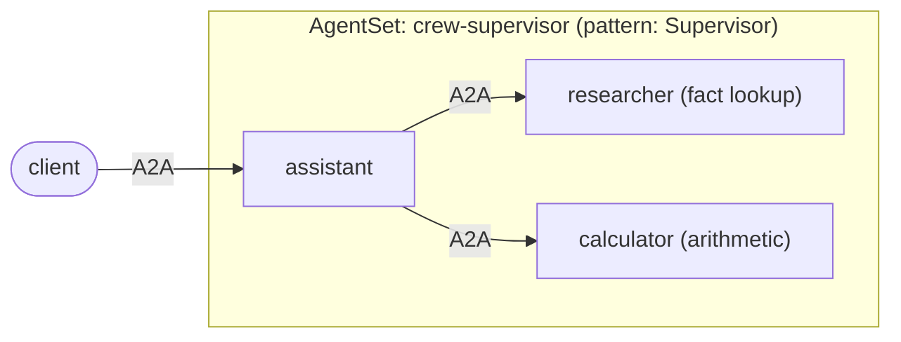

# CrewAI: supervisor with two workers

A [CrewAI](https://docs.crewai.com/) supervisor agent that delegates to two
worker agents, each running in its own pod and reached over A2A through
Kynomesh.



CrewAI does not speak A2A, and does not need to. Kynomesh's Python SDK runs each
agent's A2A server and makes the calls between agents; CrewAI only sees ordinary
tools.

| File                             | Role                                                                                                                  |
| -------------------------------- | --------------------------------------------------------------------------------------------------------------------- |
| `src/crew_assistant/agents.py`   | The three CrewAI agents and `run_agent`. The assistant's tools (`ask_researcher`, `ask_calculator`) call the workers. |
| `src/crew_assistant/peers.py`    | `ask_peer` calls a peer with `kynomesh.client.peer_client`; `blocking_ask` lets a CrewAI tool call it.                |
| `src/crew_assistant/tools.py`    | Worker tools: a small knowledge-base lookup and `add`/`multiply`/`divide`.                                            |
| `src/crew_assistant/executor.py` | Bridges an A2A message to `run_agent` and back.                                                                       |
| `src/crew_assistant/main.py`     | Serves one role via `kynomesh.server.start`; the role comes from `--role`.                                            |
| `manifests/agentset.yaml`        | One image, three agents. `pattern: Supervisor`, `entry: assistant`.                                                   |

`pattern: Supervisor` makes the entry agent see every other agent, while the
workers see nobody. Kynomesh derives that peer list from the AgentSet, which is
why `peer_client("researcher")` works in the assistant and nowhere else.

## What to know about CrewAI

- A standalone `Agent` answers a message with `kickoff_async`, so there is no
  `Task` or `Crew` to wire up. Each request starts from a clean conversation.
- **Tools run on a worker thread with their own event loop.** CrewAI does this
  for sync and async tools alike. The Kynomesh client caches peer connections
  for a single event loop, so a tool cannot just `await ask_peer(...)`. The
  assistant's tools are plain functions that call `blocking_ask`, which hands
  the A2A call back to the server's loop with `run_coroutine_threadsafe` and
  waits (up to 120s) for the reply. If it is ever called on the loop thread, it
  raises instead of deadlocking.
- A failing worker comes back to the assistant's model as an error string, so it
  can answer around it instead of the run crashing.
- Agents run on OpenAI by default. Set `OPENAI_MODEL` to pick a model (default
  `gpt-4o-mini`).
- CrewAI draws progress panels to stdout, keeps state under `$HOME` and sends
  telemetry by default. `run_agent` suppresses the panels, and the Dockerfile
  gives the `nobody` user a writable home and turns telemetry and tracing off.
- CrewAI needs Python below 3.14, so the project pins `requires-python` to
  `>=3.10,<3.14`.

Here the workers are named in the assistant's code. To discover them from
Kynomesh instead, see [dynamic-peers](../dynamic-peers).

## Prerequisites

- Python 3.10 to 3.13 and [uv](https://docs.astral.sh/uv/)
- An `OPENAI_API_KEY`. Agents refuse to start without one.
- [`a2acli`](https://github.com/kynoproj/a2acli) (optional, for the CLI calls
  below)
- For the cluster run: Docker, `kubectl`, a local Kubernetes cluster with
  [Kynomesh installed](https://github.com/kynoproj/kynomesh/blob/main/docs/quick-start.md)

## 1. Run the tests

```shell
uv run pytest    # the model and the peer calls are mocked
```

Running the three agents locally needs the Kynomesh topology file that only
exists in-cluster, so the assistant's peer calls work on Kynomesh. A worker
alone does run locally:

```shell
OPENAI_API_KEY=... uv run python -m crew_assistant.main --role calculator
a2acli -u http://localhost:8088 send 'What is 68 * 3?'
```

## 2. Run on Kynomesh

```shell
make build                     # builds crew-supervisor:latest
# kind:  kind load docker-image crew-supervisor:latest
# k3d:   k3d image import crew-supervisor:latest -c <cluster>
kubectl create secret generic openai-api-key --from-literal=OPENAI_API_KEY=...
make deploy
kubectl get agentset,agentdeploy     # AgentSet Running; 3 AgentDeploys Ready
kubectl port-forward svc/crew-supervisor-ingress 8490
```

Ask something that needs one worker, then something that needs both:

```shell
a2acli -k -u https://localhost:8490 --override-host=localhost:8490 send 'What is the capital of France?'
a2acli -k -u https://localhost:8490 --override-host=localhost:8490 send 'What is the population of France multiplied by 3?'
make delete
```

Behind a TLS-intercepting proxy the image build fails certificate checks. Pass
the proxy CA: `make build CA_CERT=/path/to/ca.pem`.

The knowledge base covers France, Japan, Kubernetes and A2A. Anything else makes
the researcher answer "No facts found".

> **Note:** each agent card sets `protocol_version` on its interfaces. Without
> it `a2acli` fails with `no compatible transports found`.
