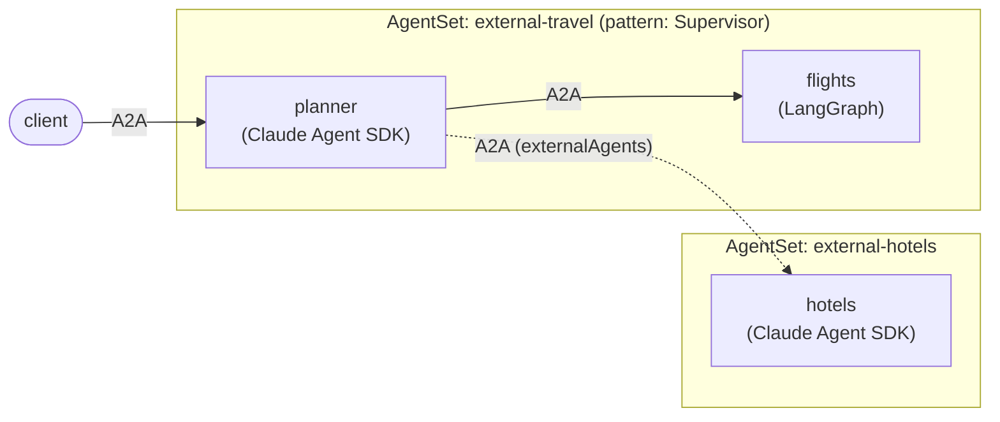

# External agent: a worker in another AgentSet

A supervisor that delegates to a worker that **lives in a different
`AgentSet`**. The travel supervisor from the dynamic-peers examples discovers
`flights` in its own `AgentSet` and `hotels` in another one, and treats them the
same way. The `AgentSet` references `hotels` as an
[external agent](https://github.com/kynoproj/kynomesh/blob/main/docs/user-guide/reference/configuration/external-agents.md).



There is no agent code here. The manifests reuse the images built by two sibling
examples, picking the agent with `--role`:

| Agent                               | Framework        | Image              | Built from                                                            |
| ----------------------------------- | ---------------- | ------------------ | --------------------------------------------------------------------- |
| `planner`                           | Claude Agent SDK | `claude-travel`    | [`claude-agent-sdk/dynamic-peers`](../claude-agent-sdk/dynamic-peers) |
| `hotels` (external, own `AgentSet`) | Claude Agent SDK | `claude-travel`    | [`claude-agent-sdk/dynamic-peers`](../claude-agent-sdk/dynamic-peers) |
| `flights`                           | LangGraph        | `langgraph-travel` | [`langgraph/dynamic-peers`](../langgraph/dynamic-peers)               |

| File                             | Role                                                                                   |
| -------------------------------- | -------------------------------------------------------------------------------------- |
| `manifests/hotels-agentset.yaml` | `hotels`, deployed as its own `AgentSet`.                                              |
| `manifests/agentset.yaml`        | Planner + `flights`, with `externalAgents: [hotels]` pointing at the other `AgentSet`. |

## What an external agent is

Nothing is deployed for it in the planner's `AgentSet`: no pod, no broker, no
scaling or probing. It is a name and a URL, and Kynomesh adds it to the entry
agent's peers like any other. The planner discovers it from its topology and
`AgentCard`, so it needs no code change and cannot tell `hotels` is external. An
external agent can be called but never be the `entry`. The other `AgentSet`
keeps managing its own pods as usual.

An agent in another `AgentSet` is served at `https://<agentset>-<agent>:8490`
(add `.<namespace>.svc` to call across namespaces), which is the `url` in the
manifest.

## TLS

Peers in the same `AgentSet` are reached over each broker's self-signed
certificate, and the Kynomesh SDK skips verification for them. An **external**
peer is expected to present a CA-signed certificate, so it is verified. But the
`hotels` broker is self-signed too, so verification would fail with
`CERTIFICATE_VERIFY_FAILED`. The planner therefore sets:

```yaml
- name: KYNOMESH_INSECURE_TLS_PEERS
  value: hotels
```

That gives the named external peer the same treatment as a sibling: encrypted,
but not authenticated. No code changes. Leave it out for a real external agent
with a CA-signed certificate. Any other auth the endpoint needs is the caller's
concern. Requires `kynomesh` 0.1.1 or newer.

## Prerequisites

- Docker, `kubectl`, and a local Kubernetes cluster with
  [Kynomesh installed](https://github.com/kynoproj/kynomesh/blob/main/docs/quick-start.md)
- [`a2acli`](https://github.com/kynoproj/a2acli)
- An `ANTHROPIC_API_KEY` (Claude agents) **and** an `OPENAI_API_KEY` (LangGraph
  agents)

## Deploy

```shell
make build                     # builds langgraph-travel and claude-travel
# k3d:   k3d image import langgraph-travel:latest claude-travel:latest -c <cluster>
# kind:  kind load docker-image langgraph-travel:latest claude-travel:latest
kubectl create secret generic anthropic-api-key --from-literal=ANTHROPIC_API_KEY=...
kubectl create secret generic openai-api-key --from-literal=OPENAI_API_KEY=...
make deploy                    # the hotels AgentSet first, then the travel AgentSet
kubectl get agentset           # two AgentSets, both Running
kubectl get agentdeploy        # hotels belongs to external-hotels
kubectl port-forward svc/external-travel-ingress 8490
```

The planner logs the workers it found. `hotels` is in the list even though it is
deployed elsewhere:

```shell
kubectl logs -l app.kubernetes.io/name=external-travel-planner -c agent | grep discovered
a2acli -k -u https://localhost:8490 --override-host=localhost:8490 \
  send 'Plan a weekend in Tokyo: flights from SFO and a hotel'
```

The answer combines `flights` (this `AgentSet`) and `hotels` (the other one).
See the call arrive on the other side:

```shell
kubectl logs -l app.kubernetes.io/name=external-hotels-hotels -c agent
```

Remove both with `make delete`.

Behind a TLS-intercepting proxy the image builds fail certificate checks. Pass
the proxy CA: `make build CA_CERT=/path/to/ca.pem`.
