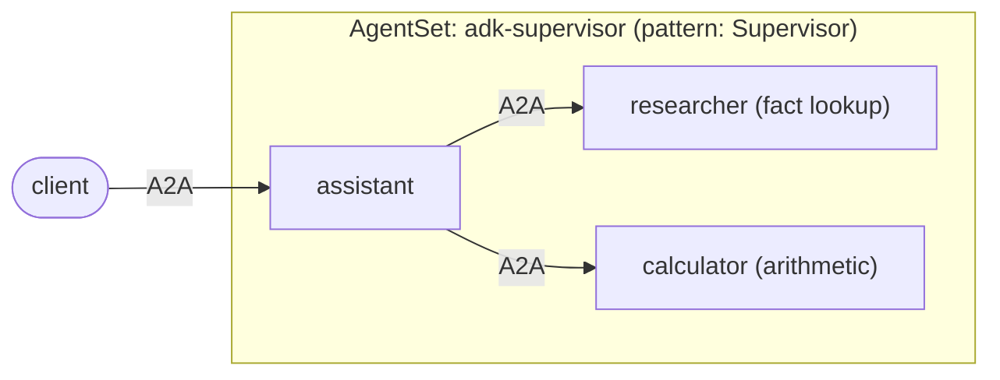

# Google ADK: supervisor with two workers

A [Google ADK](https://google.github.io/adk-docs/) supervisor agent that
delegates to two worker agents, each running in its own pod and reached over A2A
through Kynomesh.

The entry agent is named `assistant`. With `pattern: Supervisor` it is the
supervisor: it sees every other agent and delegates to them.

The entry agent is named `assistant`. With `pattern: Supervisor` it is the
supervisor: it sees every other agent and delegates to them.



ADK has its own A2A support, but this example does not use it. Kynomesh's Python
SDK runs each agent's A2A server and makes the calls between agents; ADK only
sees ordinary function tools.

| File                            | Role                                                                                                               |
| ------------------------------- | ------------------------------------------------------------------------------------------------------------------ |
| `src/adk_assistant/agents.py`   | The three ADK agents and `run_agent`. The assistant's tools (`ask_researcher`, `ask_calculator`) call the workers. |
| `src/adk_assistant/peers.py`    | `ask_peer`: calls a peer with `kynomesh.client.peer_client`. No URLs anywhere.                                     |
| `src/adk_assistant/tools.py`    | Worker tools: a small knowledge-base lookup and `add`/`multiply`/`divide`.                                         |
| `src/adk_assistant/executor.py` | Bridges an A2A message to `run_agent` and back.                                                                    |
| `src/adk_assistant/main.py`     | Serves one role via `kynomesh.server.start`; the role comes from `--role`.                                         |
| `manifests/agentset.yaml`       | One image, three agents. `pattern: Supervisor`, `entry: assistant`.                                                |

`pattern: Supervisor` makes the entry agent see every other agent, while the
workers see nobody. Kynomesh derives that peer list from the AgentSet, which is
why `peer_client("researcher")` works in the assistant and nowhere else.

Here the workers are named in the assistant's code. To discover them from
Kynomesh instead, see [dynamic-peers](../dynamic-peers).

## What to know about ADK

- Agents run on Gemini through the Gemini API. Set `GOOGLE_MODEL` to pick a
  model (default `gemini-2.5-flash`).
- Tools are plain functions. ADK takes the schema from the type hints and the
  description from the docstring, so describe every argument there.
- Each request runs in a fresh in-memory session, so requests are independent.
- A failing worker comes back to the assistant's model as an error result, so it
  can answer around it instead of the run crashing.

## Prerequisites

- Python 3.10+ and [uv](https://docs.astral.sh/uv/)
- A `GOOGLE_API_KEY` from
  [Google AI Studio](https://aistudio.google.com/apikey). Agents refuse to start
  without one.
- [`a2acli`](https://github.com/kynoproj/a2acli) (optional, for the CLI calls
  below)
- For the cluster run: Docker, `kubectl`, a local Kubernetes cluster with
  [Kynomesh installed](https://github.com/kynoproj/kynomesh/blob/main/docs/quick-start.md)

## 1. Run the tests

```shell
uv run pytest    # the model and the peer calls are mocked
```

Running the three agents locally needs the Kynomesh topology file that only
exists in-cluster, so the assistant's peer calls work on Kynomesh. A worker
alone does run locally:

```shell
GOOGLE_API_KEY=... uv run python -m adk_assistant.main --role calculator
a2acli -u http://localhost:8088 send 'What is 68 * 3?'
```

## 2. Run on Kynomesh

```shell
make build                     # builds adk-supervisor:latest
# kind:  kind load docker-image adk-supervisor:latest
# k3d:   k3d image import adk-supervisor:latest -c <cluster>
kubectl create secret generic google-api-key --from-literal=GOOGLE_API_KEY=...
make deploy
kubectl get agentset,agentdeploy     # AgentSet Running; 3 AgentDeploys Ready
kubectl port-forward svc/adk-supervisor-ingress 8490
```

Ask something that needs one worker, then something that needs both:

```shell
a2acli -k -u https://localhost:8490 --override-host=localhost:8490 send 'What is the capital of France?'
a2acli -k -u https://localhost:8490 --override-host=localhost:8490 send 'What is the population of France multiplied by 3?'
make delete
```

Behind a TLS-intercepting proxy the image build fails certificate checks. Pass
the proxy CA: `make build CA_CERT=/path/to/ca.pem`.

The knowledge base covers France, Japan, Kubernetes and A2A. Anything else makes
the researcher answer "No facts found".

> **Note:** each agent card sets `protocol_version` on its interfaces. Without
> it `a2acli` fails with `no compatible transports found`.
