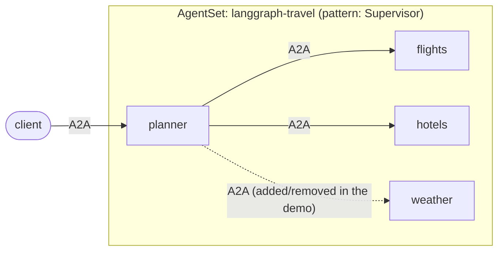

# LangGraph: a supervisor that discovers its workers

A travel-planning supervisor whose worker agents are **not named in its code**.
At startup it asks Kynomesh who its peers are, reads each peer's `AgentCard`,
and generates one tool per worker from that card. Add or remove a worker in the
`AgentSet` and the supervisor picks it up without a code change or a new image.

The entry agent is named `planner`. With `pattern: Supervisor` it is the
supervisor: it sees every other agent and delegates to them.

The entry agent is named `planner`. With `pattern: Supervisor` it is the
supervisor: it sees every other agent and delegates to them.



| File                                   | Role                                                                                           |
| -------------------------------------- | ---------------------------------------------------------------------------------------------- |
| `src/travel/discovery.py`              | `client.peers()` + `client.resolve_agent_card()` → `WorkerInfo` per peer. No names.            |
| `src/travel/supervisor.py`             | Builds one `ask_<peer>` tool per worker, and the prompt's worker list, from those cards.       |
| `src/travel/workers.py`                | The roles this image _can_ run: `flights`, `hotels`, `weather` (stub tools, no external APIs). |
| `src/travel/main.py`                   | `--role planner` or a worker role. The manifest decides which workers exist.                   |
| `manifests/agentset.yaml`              | Planner + `flights` + `hotels`, with `driftReload` on.                                         |
| `manifests/agentset-with-weather.yaml` | The same plus `weather`.                                                                       |

## How the pieces fit

- **Peers come from the topology.** With `pattern: Supervisor`, Kynomesh gives
  the entry agent a peer list of every other agent. The SDK reads it once per
  process, so the planner's worker set is fixed until its pod restarts.
- **Drift reload covers changed cards.** If a worker's `AgentCard` changes (for
  example it gains a skill), `driftReload` restarts the pods holding the stale
  card, and the planner rebuilds its tools from the new one. This is not instant
  (see step 4). See
  [Drift Reload](https://github.com/kynoproj/kynomesh/blob/main/docs/user-guide/reference/drift-reload.md).
- **Discovery warms each peer with `peer_client`.** That records the peer's card
  hash, which `driftReload` compares against. A peer this process never built a
  client for is "unknown" to drift detection, so without the warm-up a card
  change on a not-yet-called worker would go unnoticed.
- **Workers may not be up yet.** Every agent in the `AgentSet` starts at the
  same time, so a worker is often still starting when the planner looks for it.
  Discovery retries each worker for about a minute. If one is still unreachable,
  the planner exits with an error and Kubernetes restarts the pod, which tries
  again. The planner never serves with a worker missing.
- **A failing worker doesn't fail the request.** The planner's tool returns the
  error to the model, so it can answer around it.

## Prerequisites

- Python 3.10+ and [uv](https://docs.astral.sh/uv/)
- An `OPENAI_API_KEY`. Agents refuse to start without one.
- [`a2acli`](https://github.com/kynoproj/a2acli)
- Docker, `kubectl`, and a local Kubernetes cluster with
  [Kynomesh installed](https://github.com/kynoproj/kynomesh/blob/main/docs/quick-start.md)

## 1. Run the tests

```shell
uv run pytest    # LLM and A2A calls are mocked
```

The planner needs the Kynomesh topology, which only exists in-cluster. A worker
runs locally: `OPENAI_API_KEY=... uv run python -m travel.main --role flights`.

## 2. Deploy

```shell
make build                     # builds langgraph-travel:latest
# k3d:   k3d image import langgraph-travel:latest -c <cluster>
# kind:  kind load docker-image langgraph-travel:latest
kubectl create secret generic openai-api-key --from-literal=OPENAI_API_KEY=...
make deploy
kubectl get agentset,agentdeploy
kubectl port-forward svc/langgraph-travel-ingress 8490
```

Ask it something. The planner logs the workers it found:

```shell
kubectl logs -l app.kubernetes.io/name=langgraph-travel-planner -c agent | grep discovered
a2acli -k -u https://localhost:8490 --override-host=localhost:8490 \
  send 'Plan a weekend in Tokyo: flights from SFO and a hotel'
a2acli -k -u https://localhost:8490 --override-host=localhost:8490 \
  send 'What is the weather in Tokyo this weekend?'      # no worker for this yet
```

## 3. Add a worker: no code change

```shell
kubectl apply -f manifests/agentset-with-weather.yaml
kubectl get pods -w                                      # planner restarts
kubectl logs -l app.kubernetes.io/name=langgraph-travel-planner -c agent | grep discovered
a2acli ... send 'What is the weather in Tokyo this weekend?'   # now answered
```

Remove it again with `kubectl apply -f manifests/agentset.yaml`. The planner
goes back to two workers.

## 4. Change a worker's card: drift reload

The workers read an optional `EXTRA_SKILLS` env var that adds skills to their
card. It stands in for shipping a new version of an agent that gained a skill.

```shell
kubectl patch agentset langgraph-travel --type=json -p='[
  {"op":"add","path":"/spec/agents/2/container/env/-",
   "value":{"name":"EXTRA_SKILLS","value":"price-comparison"}}]'
```

`/spec/agents/2` is `hotels`. Once its pods roll, Kynomesh detects that the
`hotels` card changed and restarts the planner, whose `ask_hotels` tool now
lists the new skill.

**Give it a few minutes.** The planner does not restart as soon as the `hotels`
pods are back, and that is expected, not a failure. Kynomesh waits for the
changed card to stay stable, and for the rollout to finish, before it restarts
the planner.

```shell
kubectl get pods -w                    # the planner restarts after a few minutes
```

Check the planner's pod age to confirm the restart. For the mechanism, see the
[AgentCard drift detection spec](https://kyno.sh/stable/development/specifications/agentcard-drift-reload/).

Clean up with `make delete`.

Behind a TLS-intercepting proxy the image build fails certificate checks. Pass
the proxy CA: `make build CA_CERT=/path/to/ca.pem`.
