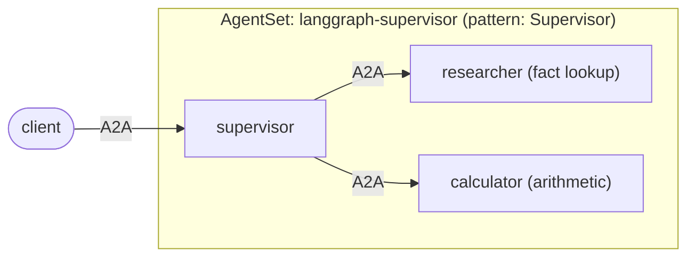

# LangGraph: supervisor with two workers

A [LangGraph](https://langchain-ai.github.io/langgraph/) supervisor agent that
delegates to two worker agents, each running in its own pod and reached over A2A
through Kynomesh.



| File                        | Role                                                                                                      |
| --------------------------- | --------------------------------------------------------------------------------------------------------- |
| `src/assistant/agents.py`   | The three LangGraph agents. The supervisor's tools (`ask_researcher`, `ask_calculator`) call the workers. |
| `src/assistant/peers.py`    | `ask_peer`: calls a peer with `kynomesh.client.peer_client`. No URLs anywhere.                            |
| `src/assistant/tools.py`    | Worker tools: a small knowledge-base lookup and `add`/`multiply`/`divide`.                                |
| `src/assistant/executor.py` | Bridges A2A messages to a LangGraph agent with `messages` state.                                          |
| `src/assistant/main.py`     | Serves one role via `kynomesh.server.start`; the role comes from `--role`.                                |
| `manifests/agentset.yaml`   | One image, three agents. `pattern: Supervisor`, `entry: supervisor`.                                      |

`pattern: Supervisor` makes the entry agent see every other agent, while the
workers see nobody. Kynomesh derives that peer list from the AgentSet, which is
why `peer_client("researcher")` works in the supervisor and nowhere else.

A failing worker (for example one that is still starting) doesn't fail the
request: the supervisor's tool returns the error to the model, so it can answer
around it.

## Prerequisites

- Python 3.10+ and [uv](https://docs.astral.sh/uv/)
- An `OPENAI_API_KEY`. Agents refuse to start without one.
- [`a2acli`](https://github.com/kynoproj/a2acli) (optional, for the CLI calls
  below)
- For the cluster run: Docker, `kubectl`, a local Kubernetes cluster with
  [Kynomesh installed](https://github.com/kynoproj/kynomesh/blob/main/docs/quick-start.md)

## 1. Run the tests

```shell
uv run pytest    # the LLM and the peer calls are mocked
```

Running the three agents locally needs the Kynomesh topology file that only
exists in-cluster, so the supervisor's peer calls work on Kynomesh. A worker
alone does run locally:

```shell
OPENAI_API_KEY=... uv run python -m assistant.main --role calculator
a2acli -u http://localhost:8088 send 'What is 68 * 3?'
```

## 2. Run on Kynomesh

```shell
make build                     # builds langgraph-supervisor:latest
# kind:  kind load docker-image langgraph-supervisor:latest
# k3d:   k3d image import langgraph-supervisor:latest -c <cluster>
kubectl create secret generic openai-api-key --from-literal=OPENAI_API_KEY=...
make deploy
kubectl get agentset,agentdeploy     # AgentSet Running; 3 AgentDeploys Ready
kubectl port-forward svc/langgraph-supervisor-ingress 8490
```

Ask something that needs one worker, then something that needs both:

```shell
a2acli -k -u https://localhost:8490 --override-host=localhost:8490 send 'What is the capital of France?'
a2acli -k -u https://localhost:8490 --override-host=localhost:8490 send 'What is the population of France multiplied by 3?'
make delete
```

Behind a TLS-intercepting proxy the image build fails certificate checks. Pass
the proxy CA: `make build CA_CERT=/path/to/ca.pem`.

The knowledge base covers France, Japan, Kubernetes and A2A. Anything else makes
the researcher answer "No facts found".

> **Note:** each agent card sets `protocol_version` on its interfaces. Without
> it `a2acli` fails with `no compatible transports found`.
