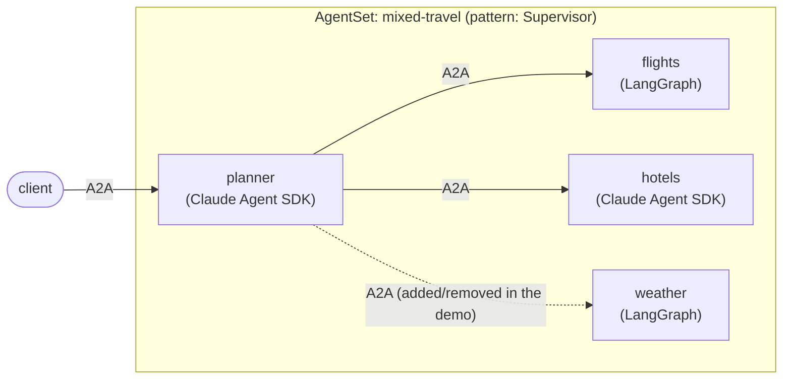

# Mixed fleet: Claude Agent SDK and LangGraph in one AgentSet

One `AgentSet` whose agents are built with **different frameworks**. A Claude
Agent SDK supervisor delegates to workers written with LangGraph and with the
Claude Agent SDK, and none of them knows or cares what the others are built
with. They only see `AgentCard`s and A2A endpoints, which is what Kynomesh's
language and framework independence means in practice.



There is no new agent code here. The manifest reuses the images built by two
sibling examples, picking the framework per agent with `image` and the agent
with `--role`:

| Agent                | Framework        | Image              | Built from                                                            |
| -------------------- | ---------------- | ------------------ | --------------------------------------------------------------------- |
| `planner`            | Claude Agent SDK | `claude-travel`    | [`claude-agent-sdk/dynamic-peers`](../claude-agent-sdk/dynamic-peers) |
| `hotels`             | Claude Agent SDK | `claude-travel`    | [`claude-agent-sdk/dynamic-peers`](../claude-agent-sdk/dynamic-peers) |
| `flights`, `weather` | LangGraph        | `langgraph-travel` | [`langgraph/dynamic-peers`](../langgraph/dynamic-peers)               |

The planner discovers its workers at startup from the Kynomesh topology and
their cards, so it picks up a worker the same way whichever framework runs it.
Read those two examples for how discovery, drift reload and the lockdown work.

## Prerequisites

- Docker, `kubectl`, and a local Kubernetes cluster with
  [Kynomesh installed](https://github.com/kynoproj/kynomesh/blob/main/docs/quick-start.md)
- [`a2acli`](https://github.com/kynoproj/a2acli)
- An `ANTHROPIC_API_KEY` (Claude agents) **and** an `OPENAI_API_KEY` (LangGraph
  agents). Each agent only gets the key its framework needs.

## Deploy

```shell
make build                     # builds langgraph-travel and claude-travel
# k3d:   k3d image import langgraph-travel:latest claude-travel:latest -c <cluster>
# kind:  kind load docker-image langgraph-travel:latest claude-travel:latest
kubectl create secret generic anthropic-api-key --from-literal=ANTHROPIC_API_KEY=...
kubectl create secret generic openai-api-key --from-literal=OPENAI_API_KEY=...
make deploy
kubectl get agentset,agentdeploy
kubectl port-forward svc/mixed-travel-ingress 8490
```

The planner logs the workers it found, and the pods show which image each agent
runs:

```shell
kubectl logs -l app.kubernetes.io/name=mixed-travel-planner -c agent | grep discovered
kubectl get pods -o custom-columns='POD:.metadata.name,IMAGE:.spec.initContainers[?(@.name=="agent")].image'
a2acli -k -u https://localhost:8490 --override-host=localhost:8490 \
  send 'Plan a weekend in Tokyo: flights from SFO and a hotel'
```

The answer combines `flights` (LangGraph) and `hotels` (Claude).

## Add a LangGraph worker to a Claude planner

```shell
kubectl apply -f manifests/agentset-with-weather.yaml
kubectl get pods -w                                      # planner restarts
kubectl logs -l app.kubernetes.io/name=mixed-travel-planner -c agent | grep discovered
a2acli ... send 'What is the weather in Tokyo this weekend?'
```

Remove it again with `kubectl apply -f manifests/agentset.yaml`.

Clean up with `make delete`.

Behind a TLS-intercepting proxy the image builds fail certificate checks. Pass
the proxy CA: `make build CA_CERT=/path/to/ca.pem`.
